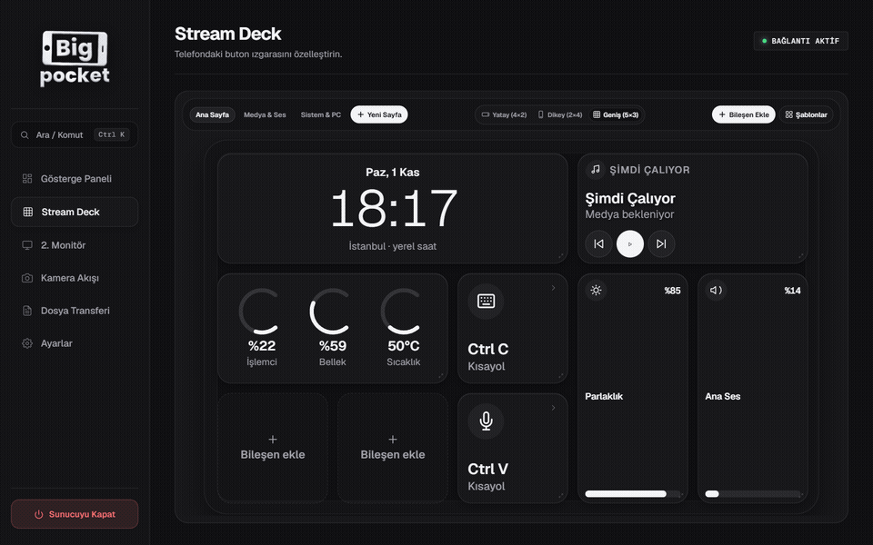
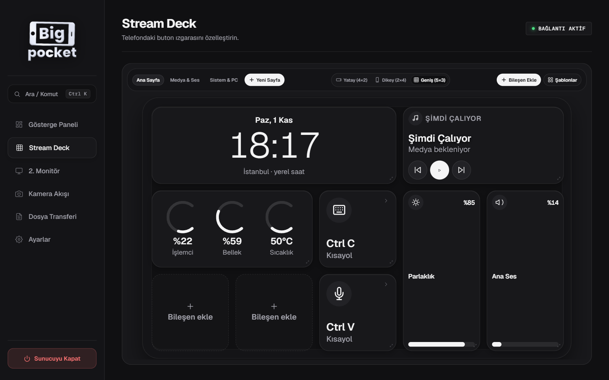
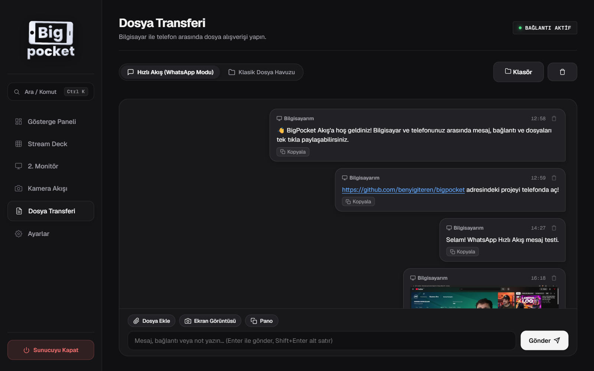
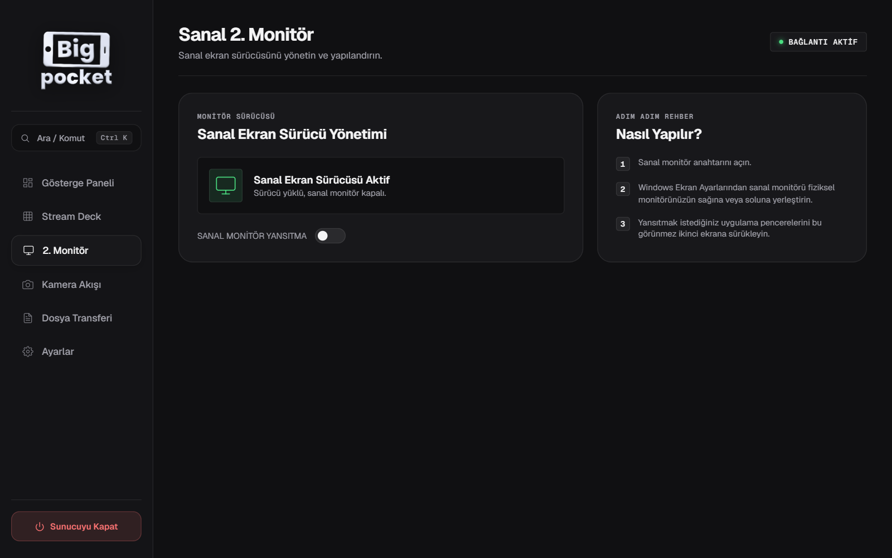
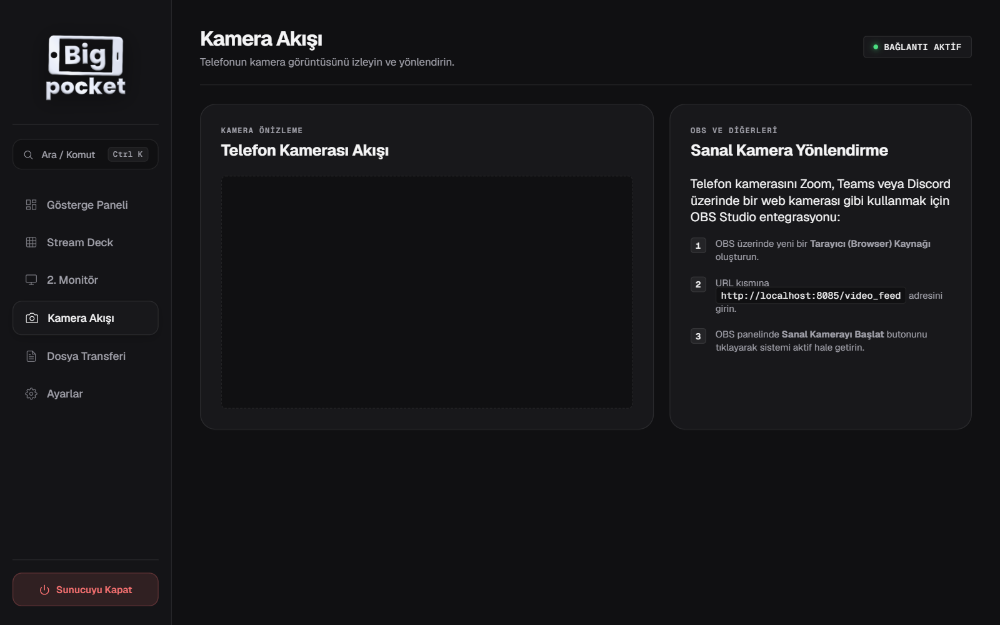
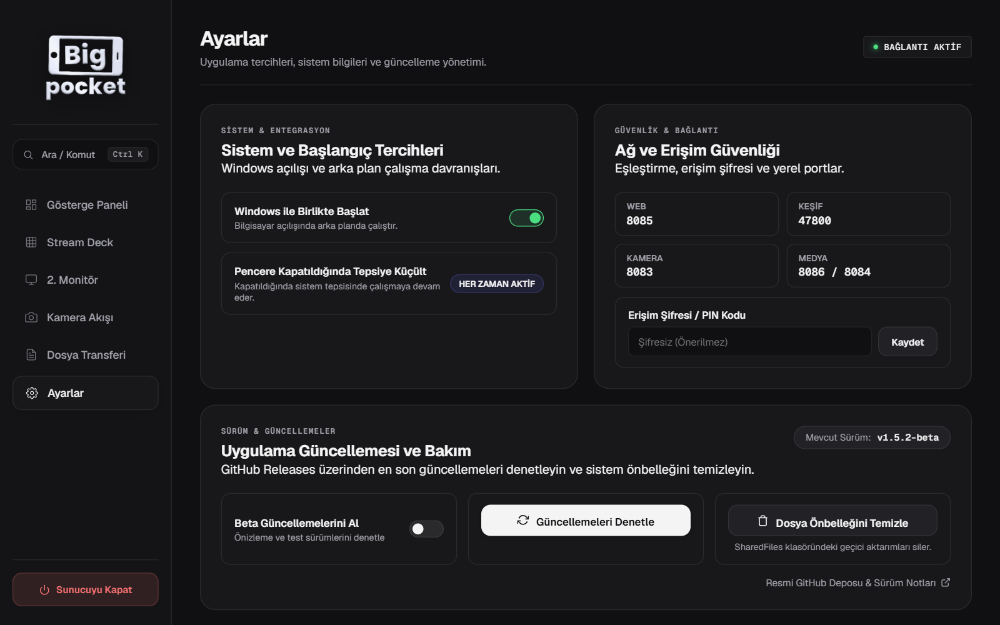

# BigPocket 📱💻

 

**Telefonunuzu Windows için Sanal 2. Monitör, Sanal Mikrofon, Stream Deck, Webcam ve Dosya Aktarım Merkezine Dönüştürün.**

[İndir (Releases)](https://github.com/benyigiteren/bigpocket/releases) • [Özellikler](#-temel-özellikler) • [Ekran Görüntüleri](#-uygulama-arayüzü) • [Kurulum](#-kurulum-ve-çalıştırma)

---

## ⚡ BigPocket Nedir?

**BigPocket**, Windows bilgisayarınızı akıllı telefonunuz üzerinden sıfır gecikmeyle yönetmenizi sağlayan modern, yüksek performanslı ve açık kaynaklı bir uzaktan kontrol ve donanım genişletme ekosistemidir. 

**Rust (Tauri v2 + Tokio + Axum)** ile yazılmış hafif masaüstü sunucusu ve **Kotlin / Jetpack Compose** ile geliştirilmiş akıcı Android istemcisi sayesinde minimum CPU tüketimi ve maksimum tepki hızı sunar.

---

## 📸 Uygulama Arayüzü

### 🎛️ 1. Stream Deck & Bento Studio
Apple kilit ekranı tarzı saat kartı, canlı müzik/video çalar (YouTube & Spotify albüm kapağı ve ilerleme çubuğu), sistem telemetrisi (İşlemci, Bellek, Sıcaklık halkaları) ve iOS Denetim Merkezi tarzı ses/parlaklık kapsül kaydırıcıları.

---

### 💬 2. WhatsApp Tarzı Hızlı Akış & Dosya Transferi (Local Flow)
Telefon ve bilgisayar arasında mesajlaşma, bağlantı paylaşımı ve doğrudan **İndirilenler (Downloads)** klasörüne otomatik kaydedilen dosya alışverişi.

---

### 🖥️ 3. Sanal 2. Monitör (Virtual Display)
Windows Indirect Display Driver entegrasyonu sayesinde telefonunuzu gerçek bir ikinci monitöre dönüştürün. Dokunmatik ekran desteğiyle pencereleri sürükleyip bırakın.

---

### 📷 4. Kamera Akışı & Sanal Webcam
Telefon kameranızı yüksek kaliteli, düşük gecikmeli bir MJPEG web kamerasına dönüştürün. OBS Studio, Zoom, Discord ve tarayıcılarla %100 uyumludur.

---

### ⚙️ 5. Sistem Yönetimi & Ayarlar
Koyu antrasit tema, ağ güvenliği, otomatik başlangıç, yerel IP yapılandırmaları ve tek tıkla güncelleme denetimi.

---

## 🚀 Temel Özellikler

* **📱 Çok Fonksiyonlu Stream Deck:**
  * Bento ızgara sistemi (1×1, 1×2, 2×1, 2×2 hücreler).
  * Canlı YouTube & Spotify medya oynatıcısı (albüm kapağı, anlık video süresi, donanımsal durdur/atla kontrolleri).
  * Apple tarzı hassas ses ve ekran parlaklığı kapsül sürgüleri (`Pill Sliders`).
  * Elgato Stream Deck+ tarzı döner kadranlar (`Rotary Dials`).
* **📁 WhatsApp Tarzı Local Flow:**
  * Bilgisayar ve telefon arasında çift yönlü anlık mesajlaşma.
  * Aktarılan dosyalar hem Android'de hem Windows'ta doğrudan **İndirilenler (Downloads/BigPocket)** klasörüne kaydedilir.
  * Anlık pano (Clipboard) eşitleme.
* **🖥️ Sanal İkinci Monitör (IDD):**
  * Donanımsal sanal ekran simülasyonu.
  * Dokunmatik giriş ve fare kontrolleri.
* **🎤 Sanal Mikrofon (VB-Cable Entegrasyonu):**
  * Telefonunuzun mikrofonunu Discord, Zoom, Teams ve OBS için stüdyo mikrofonu olarak kullanın.
* **⚡ Sıfır Gecikmeli Bağlantı:**
  * UDP Broadcast ile otomatik yerel ağ keşfi (IP girmeden bağlanma).
  * USB Tethering ile ultra düşük gecikmeli kablolu bağlantı seçeneği.
* **🔍 Hızlı Komut Paleti (`Ctrl+K`):**
  * Raycast / Spotlight tarzı klavye odaklı hızlı komut ve uygulama başlatıcı.

---

## 🔌 Bağlantı Seçenekleri

### ⚡ Sıfır Gecikmeli USB Bağlantısı (Önerilen)
1. Telefonu USB kablosuyla bilgisayara bağlayın.
2. Telefondan **Ayarlar > Bağlantılar > USB İnternet Paylaşımı (Tethering)** özelliğini açın.
3. Bilgisayar arayüzünde "Bilgisayar IP Adresi" listesinden otomatik tespit edilen **(USB Tethering)** IP'sini seçin.
4. Telefon uygulamasından **"USB ile Otomatik Bağlan"** butonuna basarak sıfır gecikmeyle bağlanın.

### 📶 Wi-Fi / Yerel Ağ Bağlantısı
1. Bilgisayarınızın ve telefonunuzun aynı Wi-Fi ağına bağlı olduğundan emin olun.
2. Telefon uygulamasını açtığınızda bilgisayarınız otomatik olarak bulunur ve listelenir; tek dokunuşla bağlanabilirsiniz.

---

## 📦 Kurulum ve Çalıştırma

### 💻 Windows Sunucusu (Bilgisayar)
1. [Releases](https://github.com/benyigiteren/bigpocket/releases) sayfasından en son **BigPocket-Setup.exe** veya **bigpocket-windows.zip** dosyasını indirin.
2. Kurulumu tamamlayın. Uygulama sistem tepsisinde (tray) arka planda otomatik çalışmaya başlar.

### 📱 Android İstemcisi (Telefon)
1. [Releases](https://github.com/benyigiteren/bigpocket/releases) sayfasından veya ana dizindeki **[BigPocket.apk](BigPocket.apk)** dosyasını telefonunuza yükleyin.
2. Kamera ve mikrofon izinlerini onaylayın.

---

## 📄 Lisans
Bu proje açık kaynaklı olup **MIT Lisansı** altında dağıtılmaktadır.
